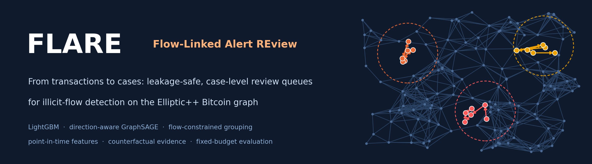
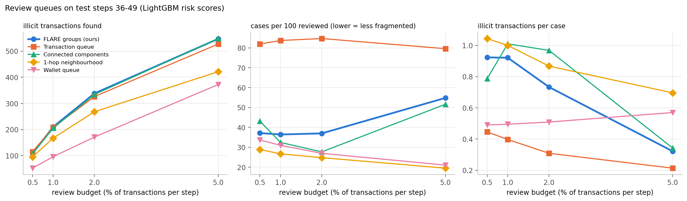
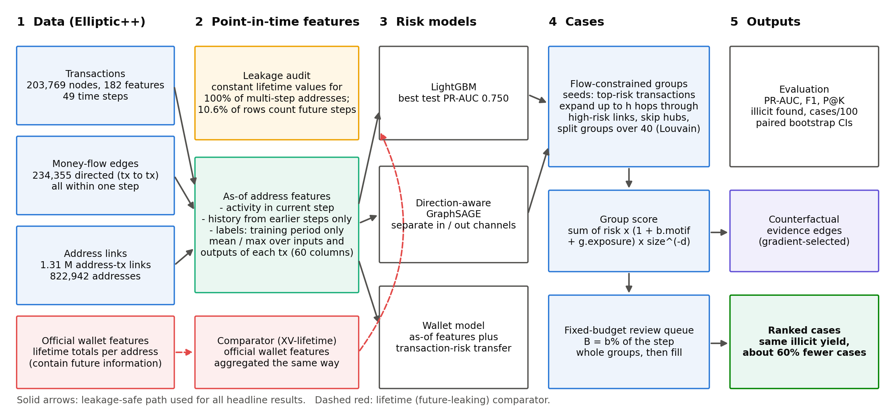
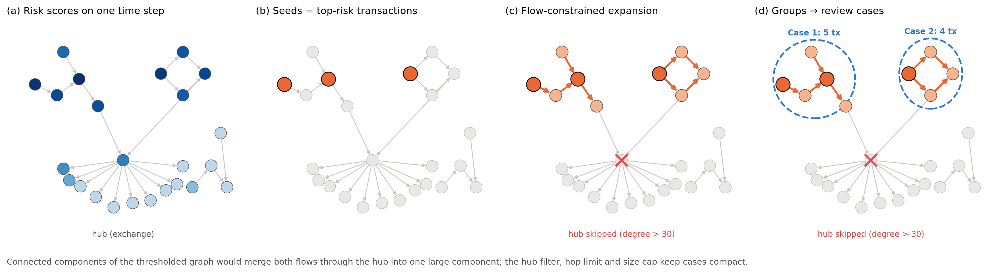
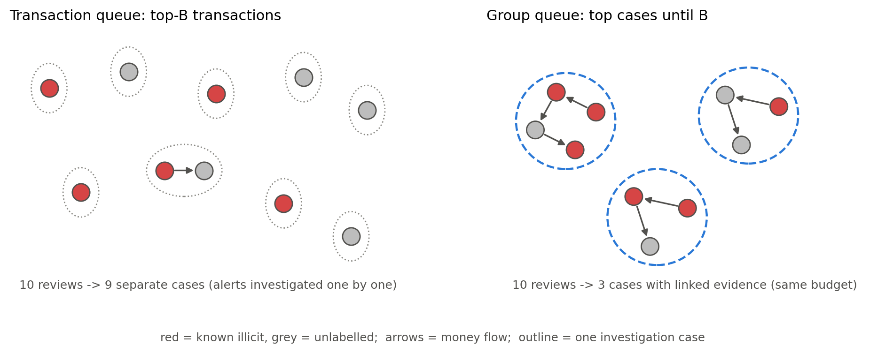
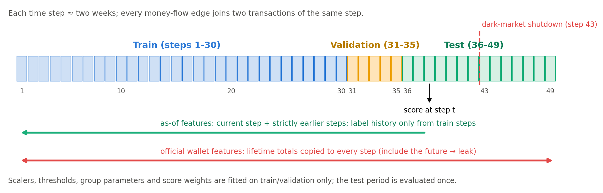
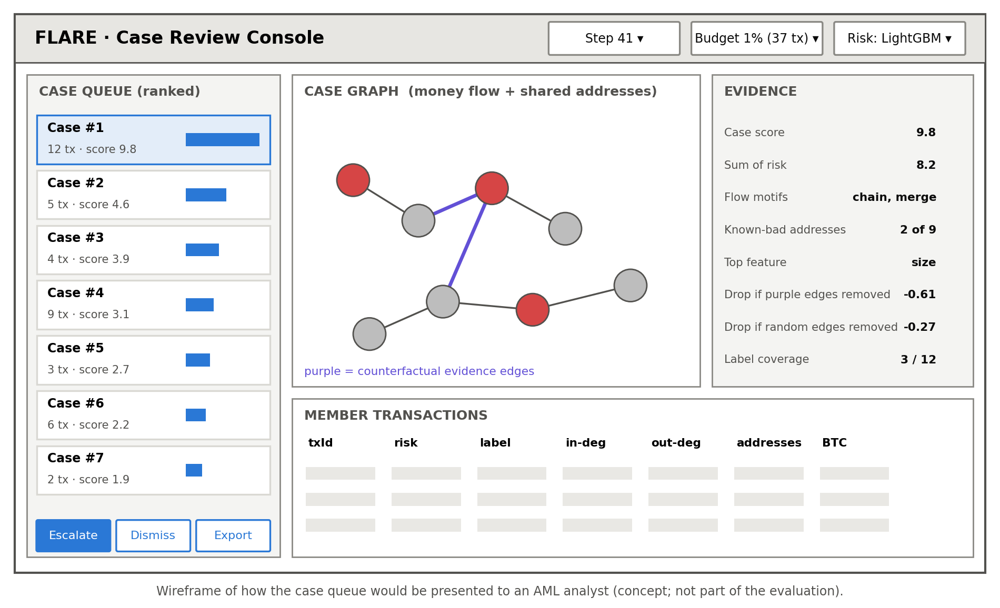

<p align="center">
  
</p>

<p align="center">
  
  
  
  
  
</p>

# FLARE: Flow-Linked Alert REview

**Leakage-safe, case-level review queues for illicit Bitcoin flows on Elliptic++.**

Anti-money-laundering (AML) analysts cannot review every alert. A model that scores transactions
one by one hands them a ranked list of **isolated alerts**; related transactions from the same
laundering flow arrive as separate, disconnected tasks. This repository studies a simple change of
unit: **rank cases, not transactions.** Starting from high-risk transactions, money-flow and
shared-address links are followed (with hub and size limits) to build compact *flow groups*, and the
analyst reviews whole groups within the same fixed budget. **FLARE** (Flow-Linked Alert REview) is the
name of this pipeline: alerts are linked along money flows and reviewed as cases.

Everything is evaluated on the public **Elliptic++** Bitcoin dataset under a strict
chronological protocol (train steps 1-30, validation 31-35, test 36-49), with point-in-time
features only.

> M.Sc. (Economics) Thesis Project (BTP-1), Department of Humanities and Social Sciences, IIT Kharagpur, 2026.
> Author: **Sourav Choudhary** (23HS23017). Supervisor: Prof. Gourishankar S. Hiremath.

---

## Key findings

| | Transaction queue | **FLARE groups (ours)** |
|---|---|---|
| Illicit transactions found, 1% budget (LightGBM risk) | 208 | **210** (difference not significant) |
| Separate cases per 100 reviews | 83.7 | **36.4** (−296 cases, 95% CI [−400, −212]) |
| Illicit found with only 10% of training labels | 175 ± 11 | **201 ± 12** |
| Illicit found, 2% budget (GraphSAGE risk) | 266 | **310** (+44, 95% CI [+3, +90]) |

1. **Same yield, less than half the cases.** Group queues find as many illicit transactions as
   transaction-level queues while cutting case fragmentation by about 55-60% at every budget.
2. **More robust when labels are scarce.** With 10-20% of training labels the transaction queue's
   yield drops by about 16%; group queues keep it (+15-17%).
3. **The official Elliptic++ wallet features leak future information.** They are lifetime totals
   repeated at every time step (identical across steps for 100% of multi-step addresses; 10.6% of
   rows count steps that have not happened yet). Point-in-time replacements perform as well or better.
4. **Tree models remain the strongest scorers** (LightGBM PR-AUC 0.750 vs 0.720 for a direction-aware
   GraphSAGE), and *every* model collapses after the dark-market shutdown at step 43.
5. **Explanations pass a counterfactual test:** deleting the gradient-selected evidence edges lowers
   a group's score 2-4 times more than deleting random edges.

Honest negatives: the extra terms of the proposed group score (flow-motif density, known-bad
exposure) do not beat a plain *sum of member risk* on test, and connected components of the
risk-thresholded graph are an equally strong grouping baseline in yield. See
[docs/RESULTS.md](docs/RESULTS.md) for every number.

<p align="center">
  
</p>

## How it works

<p align="center">
  
</p>

| Stage | What happens | Code |
|---|---|---|
| Point-in-time features | Address activity in the current step plus history from strictly earlier steps; label history only from the training period. Aggregated (mean/max) to each transaction's inputs and outputs. | [`flare/asof.py`](src/flare/asof.py) |
| Risk models | LightGBM, random forest, logistic regression and a direction-aware GraphSAGE with separate incoming/outgoing flow channels. | [`flare/models.py`](src/flare/models.py), [`kaggle/main/btp_main.py`](kaggle/main/btp_main.py) |
| Flow groups | Seeds = top-risk transactions; expand at most *h* hops through high-risk neighbours; never expand through hubs (degree > 30); split groups over 40 members with Louvain. | [`flare/groups.py`](src/flare/groups.py) |
| Review queue | Review exactly *B = b%* of a step's transactions: whole groups in score order, the last group truncated by risk, remaining capacity filled by top-risk transactions. | [`flare/queues.py`](src/flare/queues.py) |
| Evidence | Gradient of the group score w.r.t. edge weights selects evidence edges; deletion tests compare against random, bottom-ranked and heuristic edges. | [`flare/counterfactual.py`](src/flare/counterfactual.py) |

<p align="center">
  
</p>

<p align="center">
  
</p>

### Leakage-safe time protocol

<p align="center">
  
</p>

### Analyst console (wireframe)

How a case queue could be presented to an investigator: ranked cases, the case graph with the
counterfactual evidence edges highlighted, and the numbers behind the score.

<p align="center">
  
</p>

## Quick start

```bash
git clone https://github.com/Onethybeing/flare.git
cd flare
pip install -e .            # numpy, scipy, pandas, networkx (torch optional)
python -m unittest discover -s tests -v     # 35 tests
python examples/quickstart.py
```

Expected output of the example (synthetic graph with three planted flows):

```
transaction queue  reviewed=20  illicit found=12  cases per 100 reviewed= 60.0  illicit per case=1.00
flow-group queue   reviewed=20  illicit found=12  cases per 100 reviewed= 25.0  illicit per case=2.40
9 candidate groups; largest has 11 transactions
```

### Use it on your own transaction graph

```python
import numpy as np
from flare import StepGraph, flow_groups, group_features, group_score, run_queue, queue_stats, pooled

G = StepGraph(n, flow_src, flow_dst, addr_a, addr_b)          # one time step (or a window)
groups = flow_groups(G, nodes, risk, seed_frac=0.015, q_exp=0.1, hops=2, hub_degree=30, max_size=40)
F = np.array([group_features(G, g, risk) for g in groups])
reviewed = run_queue(groups, group_score(F, "sum"), risk, nodes, budget=40)
print(pooled(queue_stats(G, reviewed, labels, nodes)))         # labels: 1 illicit, 0 licit, -1 unknown
```

## Reproducing the experiments

The full study runs as Kaggle notebooks (T4 GPU, about 31 min for 5 seeds plus 11 min for the
supplementary run). The public dataset mirror is `muhammadabrar78/elliptic-dataset`.

```bash
cd kaggle/main && python make_main.py full     # builds btp_main.ipynb + kernel-metadata.json
kaggle kernels push -p .                        # set your own username in kernel-metadata.json first
cd ../extra && python make_extra.py full && kaggle kernels push -p .
```

All tables in [`results/`](results/) come from those runs; `python scripts/make_figures.py` redraws
every chart from the CSVs and `python scripts/make_diagrams.py` redraws the diagrams. Details:
[docs/REPRODUCIBILITY.md](docs/REPRODUCIBILITY.md).

## Repository layout

```
src/flare/       tested package: as-of features, step graph, groups, queues, metrics, GraphSAGE, counterfactuals
tests/                35 unit tests (unittest; also runnable with pytest)
kaggle/               exact notebook sources that produced the results (main, supplementary, figure runs)
results/              all result tables (CSV + markdown) and run summaries
figures/              result charts (regenerated by scripts/make_figures.py)
docs/                 methodology, data audit, results, reproducibility; docs/assets holds diagrams
scripts/              make_figures.py, make_diagrams.py
examples/             quickstart.py
```

## Documentation

- [docs/METHODOLOGY.md](docs/METHODOLOGY.md): problem setup, features, models, grouping, scoring, metrics, equations
- [docs/DATA_AUDIT.md](docs/DATA_AUDIT.md): Elliptic++ structure and the lifetime-feature leakage finding
- [docs/RESULTS.md](docs/RESULTS.md): all experiments (E1-E6, X1-X2) with honest limitations
- [docs/REPRODUCIBILITY.md](docs/REPRODUCIBILITY.md): environment, seeds, runtimes, how each file was produced

## Data and licence notes

The raw Elliptic++ files are **not** redistributed here; download them from the authors'
repository ([git-disl/EllipticPlusPlus](https://github.com/git-disl/EllipticPlusPlus)) or the Kaggle
mirror. `results/label_counts_per_step.csv` holds only aggregate counts. Code is MIT licensed.
The analyst console is a concept wireframe and was not part of the evaluation. Results are research
screening on a public blockchain benchmark, not a production AML or compliance system.

## Citation

```bibtex
@misc{choudhary2026flare,
  author       = {Sourav Choudhary},
  title        = {FLARE: Flow-Linked Alert Review -- Leakage-Safe Case-Level Review Queues for Illicit Bitcoin Flows on Elliptic++},
  year         = {2026},
  howpublished = {M.Sc. (Economics) Thesis Project (BTP-1), Indian Institute of Technology Kharagpur},
  url          = {https://github.com/Onethybeing/flare}
}
```

## Key references

- Y. Elmougy and L. Liu, "Demystifying fraudulent transactions and illicit nodes in the Bitcoin network for financial forensics," KDD 2023. [doi:10.1145/3580305.3599803](https://doi.org/10.1145/3580305.3599803)
- M. Weber et al., "Anti-money laundering in Bitcoin: Experimenting with graph convolutional networks for financial forensics," 2019. [arXiv:1908.02591](https://arxiv.org/abs/1908.02591)
- A. Malik, "Do transaction-level and actor-level AML queues agree?," 2026. [arXiv:2604.23494](https://arxiv.org/abs/2604.23494)
- A. P. Ichull and J. C. Sopuru, "TWIN-GNN," *J. Cybersecurity and Privacy*, 2026. [doi:10.3390/jcp6060186](https://doi.org/10.3390/jcp6060186)
- W. L. Hamilton, R. Ying and J. Leskovec, "Inductive representation learning on large graphs," NeurIPS 2017. [arXiv:1706.02216](https://arxiv.org/abs/1706.02216)
- G. Ke et al., "LightGBM: A highly efficient gradient boosting decision tree," NeurIPS 2017.

The full, DOI-verified reference list is in the report and in [docs/METHODOLOGY.md](docs/METHODOLOGY.md#references).
