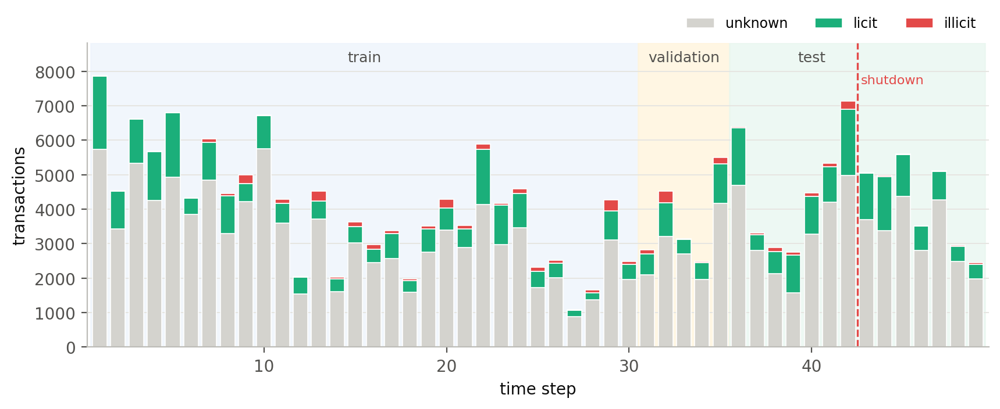
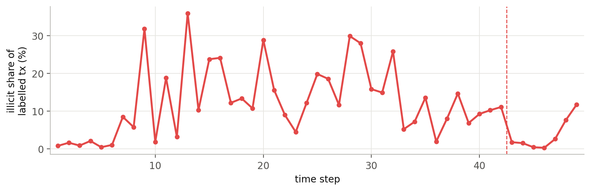

# Data audit: Elliptic++

Source: Elmougy and Liu (KDD 2023), official repository [git-disl/EllipticPlusPlus](https://github.com/git-disl/EllipticPlusPlus).
The experiments read the Kaggle mirror `muhammadabrar78/elliptic-dataset`, which contains all eight official files.

## Files and counts (as loaded)

| File | Rows | Content |
|---|---|---|
| `txs_features.csv` | 203,769 | `txId`, `Time step`, 93 local, 72 aggregate and 17 augmented features |
| `txs_classes.csv` | 203,769 | 4,545 illicit (1), 42,019 licit (2), 157,205 unknown (3) |
| `txs_edgelist.csv` | 234,355 | directed money-flow edges `txId1 -> txId2` |
| `AddrTx_edgelist.csv` | 477,117 | input address -> transaction |
| `TxAddr_edgelist.csv` | 837,124 | transaction -> output address |
| `wallets_features.csv` | 1,268,260 | address x time-step rows, 56 features |
| `wallets_classes.csv` | 822,942 | 14,266 illicit, 251,088 licit, 557,588 unknown addresses |
| `AddrAddr_edgelist.csv` | 2,868,964 | address -> address |

Labelled transactions per split: train 26,905 (2,954 illicit), validation 4,330 (690), test 15,329 (901).
Per-step counts: [`results/label_counts_per_step.csv`](../results/label_counts_per_step.csv).

## Finding 1: all flow edges are within one time step

100% of the 234,355 transaction edges join two transactions with the same `Time step`. Consequences:

* a transaction's graph neighbourhood never contains future transactions, so full-graph and step-wise
  (inductive) message passing coincide for the transaction graph;
* flow groups are necessarily within-step objects; cross-step structure only enters through addresses.

## Finding 2: official wallet features are lifetime summaries (future leakage)

`wallets_features.csv` has one row per (address, time step), which suggests point-in-time values. They are not:

| Check | Result |
|---|---|
| Addresses that appear in more than one step | 61,487 (in the matched subset of 920,691 rows) |
| ... with identical `total_txs` at every step | **100%** |
| ... with identical `last_block_appeared_in` at every step | **100%** |
| Rows whose `num_timesteps_appeared_in` exceeds the steps seen so far | **10.6%** |

So an address scored at step 25 already "knows" its total number of transactions and its last block, even if
those happen at step 45. Using these features in a chronological evaluation leaks the future. We therefore rebuilt
address features from the transaction-address links using only the current and earlier steps
(`flare/asof.py`), and kept the official features only as a labelled comparator ("lifetime").

Effect on results (test PR-AUC, mean over seeds):

| Model | As-of features | Lifetime features |
|---|---|---|
| LightGBM, transactions (+ address view) | **0.750** | 0.745 |
| Wallet model (address level), alone | 0.273 | 0.345 |
| Wallet model + transaction risk | **0.645** | 0.636 |

The lifetime features look better *on their own* at the wallet level (partly because of the future information) but add
nothing once transaction risk is available, while the as-of features are leak-free by construction.

## Finding 3: label semantics

* "Unknown" is the majority (77% of transactions) and is never used as a negative.
* There are no ring, campaign or typology identifiers, so group-level results are proxies (hit rate, purity, enrichment).
* The illicit share collapses after step 43 (a dark-market shutdown documented by Weber *et al.* 2019); every model fails there.

